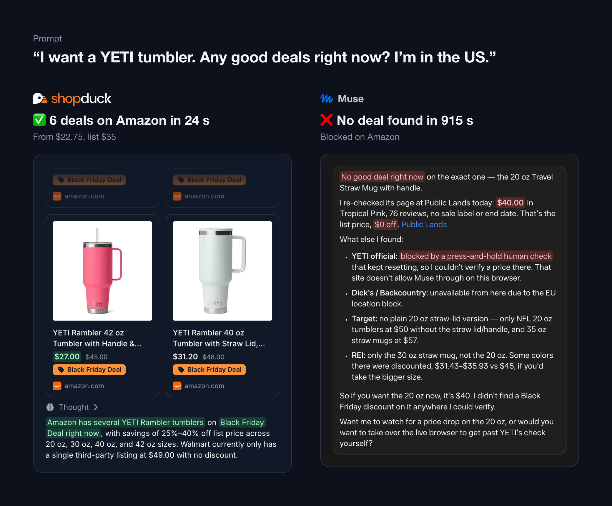

<p align="center">
  <picture>
    <source media="(prefers-color-scheme: dark)" srcset="docs/shopduck-logo-dark.svg">
    
  </picture>
</p>
<h3 align="center">The agent that shops anywhere to get you the best deals</h3>
<p align="center"><sub>Powered by <a href="https://reduck.ai">Reduck</a></sub></p>

Finding the best products at the best price means exploring many stores, but current agents like Muse are blocked on major ones.

ShopDuck solves this with [Reduck](https://reduck.ai/), which runs browser automation on stealthy cloud browsers. Reduck also maintains an [official library of scripts](https://docs.reduck.ai/core-concepts/#official-scripts) per site for fast and accurate results.

**See** ShopDuck in action to find deals other agents miss because of anti-bot restrictions:

<p align="center">
  
  <br>
  <sub>ShopDuck runs scripts like <a href="https://reduck.ai/explore/scripts/reduck/amazon.com/search-products">Amazon search</a> on a stealthy browser, which return full data, deals included. Muse is blocked on Amazon.</sub>
</p>

## Try it on [shopduck.ai](https://shopduck.ai/)

## Who is this for

ShopDuck was designed with two goals in mind:

- For end users: build the best agent for shopping
    - 100+ stores covered including: Amazon, Walmart, Best Buy, Etsy and more, including stores that block other agents.
    - **No hallucination**: data like prices are extracted programmatically with scripts versus other agents reading manually
    - **6x faster than Muse**: ShopDuck executes scripts instead of an agent loop that acts then reads screenshots. Benchmark coming soon, see Roadmap.
- For builders: highlight with an open-source project how Reduck can be combined with frameworks like Vercel [eve](https://eve.dev) to create amazing harnesses connected to any site.
    - 3x cheaper with Reduck scripts vs manual browsing: By mapping sites ahead of time and using Reduck scripts, commerce agents are much more token efficient as we do not need to do expensive input tokens ingestions of screenshots and output tokens generation of browser actions. See [Reduck Voyager Benchmark](https://blog.reduck.ai/browser-action-memory-layer-for-faster-agents/).
    - **Customizable**: Code is open source, can be inspected and forked to add custom features or add other scripts.

## Run it locally

1. Create an API key on [reduck.ai](https://reduck.ai), and one on the [Vercel AI Gateway](https://vercel.com/docs/ai-gateway).
2. Copy `.env.example` to `.env.local`, and put them in it.
3. Start the chat, then open [http://localhost:3000](http://localhost:3000):

    ```bash
    pnpm install
    pnpm dev:web
    ```

## Feature roadmap

- [ ] Core stores covered
    - [x] Amazon
    - [x] Walmart
    - [x] Target
    - [x] Best Buy
    - [x] Lowe's
    - [x] Etsy
    - [x] Nike
    - [x] Newegg
    - [x] Apple
    - [ ] eBay
    - [ ] Home Depot
    - [ ] Costco
    - [ ] Wayfair
- [x] Country detection and setup for relevant suggestions
- [x] Read only flows like search, product description and review
- [ ] Write flows like adding to cart and checkout
- [ ] Memory for shopping preferences
- [ ] Caching of search / product results
- [ ] Benchmarks with open data and reproducible code
    - [ ] ShopDuck versus B2C agents like Muse
    - [ ] ShopDuck with Reduck versus manual browsing

## Contribute

- A store is missing? [Open an issue](https://github.com/reduck-ai/shopduck/issues), and we add its script to Reduck's official library, where the agent can use it.
- A new feature? Open an issue or a pull request on [GitHub](https://github.com/reduck-ai/shopduck).
